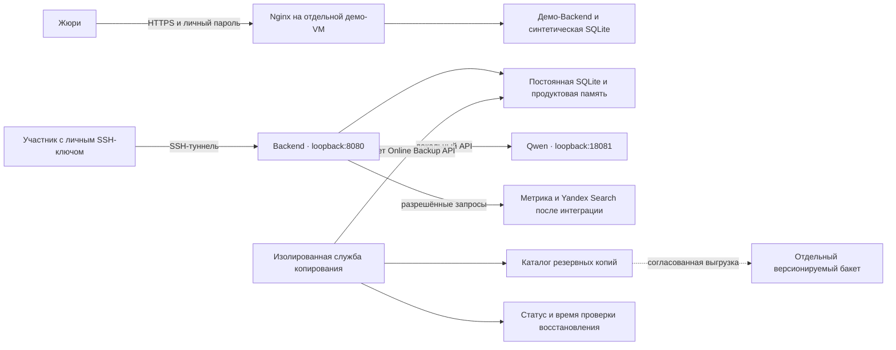

# PARADИИGMA · отчёт о развёртывании

Рабочая ветка `feature/deployment` создана от `4b931ed` в `feature/ai-core`. Эта ревизия содержит долговременную память, схему SQLite v5 и API резервного копирования. Удалённая ветка развёртывания при старте отсутствовала. Объединение с поисковым адаптером и утверждение релиза остаются за капитаном.

## Размещение и доступ

На выделенной Ubuntu 24.04 служба `paradiigma.service` запускает существующий Python Backend как `pm-app`. Приложение работает с постоянным `/var/lib/paradiigma/db`, независимо от текущей версии исходников в `/opt/paradiigma/current`. Исходные документы размещаются отдельно в `/var/lib/paradiigma/documents`. Секреты подключения хранятся у администратора в `/etc/paradiigma/app.env`. Обработанные данные остаются в общем для допущенной команды пространстве. При разном уровне допуска нужны раздельные инсталляции или изменения авторизации Backend.

## Инструкции оператору

| Задача | Порядок действий |
|---|---|
| Установить на чистом сервере | Капитан утверждает SHA и источник, администратор подготавливает Ubuntu и запускает установщик для этой ревизии. Проверяет окружение, systemd, права и loopback. [Установка и службы](docs/deployment.md) |
| Обновить или откатить | Закрыть вход на время работ, зафиксировать действующий SHA, проверить независимую копию, установить проверенную ревизию и подтвердить чтение прежней памяти. Для несовместимой схемы восстановить совместимый набор в закрытом окне. [Процедура обновления](docs/deployment.md) |
| Подключить пятерых участников | Выдать каждому собственный ограниченный SSH-доступ, подтвердить отпечаток сервера, открыть локальный проброс, проверить общую тестовую запись и отзыв конкретного ключа. [SSH и матрица доступа](docs/infrastructure_security.md) |
| Открыть демо | Выделить отдельную чистую инсталляцию с синтетическими данными, закрытым upstream, TLS и обязательной авторизацией. Проверить успешный вход и отклонение неверного Host/Origin и неаутентифицированных запросов. [Nginx, HTTPS и демо](docs/infrastructure_security.md) |
| Настроить модель | Администратор проверяет бинарник и одобренные веса с Амиром. Unit запускает существующий scripts/run_model.py от отдельного пользователя. При нехватке RAM использовать защищённый вычислительный узел и локальный SSH-проброс. [Qwen и лимиты ресурсов](docs/deployment.md) |
| Проверить копию и восстановиться | Таймер запускает независимого пользователя. Администратор выбирает проверенный снимок, восстанавливает его в новый каталог, сверяет данные, затем переключает службу. [Регламент DR и объектное хранение](docs/disaster_recovery.md) |
| Проверить состояние | Запустить scripts/deploy/health.py с правами pm-app, сравнить время последней копии и восстановления, свободное место, RAM, задержки и ошибки источников. [Интерпретация диагностики](docs/operations.md) |

## Экономика

Смета считается по измеренному потреблению и датированному региональному предложению. `scripts/deploy/estimate_cost.py --template` создаёт форму со всеми статьями, включая отдельный узел Qwen, диски, версии копий, запросы, адрес и трафик. По заполненной форме `--input` выдаёт месячную сумму и стоимость на одного менеджера. Параметры реального VPS, договорные тарифы и замеры Амира на этом узле ещё предстоит получить. [Методика расчёта и замера нагрузки](docs/operations.md)

## Результаты испытаний

На ревизии `11b48b7` проверены Ubuntu 24.04 и Windows Server 2022 с Python 3.12. В каждой матрице обнаружено 75 тестов. В непривилегированном прогоне Ubuntu прошли 74 теста, проверка с двумя UID затем прошла в отдельном задании с root. На Windows прошли 69 тестов. Шесть сценариев Nginx и POSIX-копирования выполнены в Ubuntu. [Журнал CI](https://github.com/GITKITLIT/SoftlineParadiigmaMGR/actions/runs/45965431890)

| Сценарий | Подтверждённый результат |
|---|---|
| Чистая Ubuntu и обновление | Настоящие непривилегированные службы, установка venv по хешам, повтор установки, скачивание синтетического калькулятора, восстановление прежнего SHA после отказа ExecStartPre, обновление и ручной возврат SHA. Ранее сохранённая запись пережила переключения и перезапуск службы |
| Сбой Backend и модели | Пять одновременных расследований сохранились. Backend остановлен в ожидании тестовой модели. Незавершённый запрос не попал в журнал. После перезапуска без работающей модели новый запрос вернул локальный анализ. После возврата каталога данных заработал API задач |
| Временный отказ Метрики и поиска | Тесты передали тайм-ауты через внедрённые тестовые провайдеры и подтвердили статус недоступности, ограничение в отчёте и сохранение локальной аналитики |
| TLS и доступ | Nginx с тестовым сертификатом и персональным паролем проксирует запрос к исходному Backend. Чужие Host и Origin отвергнуты. Дополнительные клиентские заголовки и пароль отсутствуют у Backend и в проверенном журнале прокси. Синтетический ключ приложения отсутствовал в HTML, настройках, журнале, отчёте и публичном экспорте |
| SQLite Backup API | Реальный backup unit через mount только для чтения снял зафиксированную запись из активного WAL и исключил незавершённую транзакцию. Та же служба успешно сняла восстановленную WAL-базу после закрытия последнего клиента. Пробное восстановление проверяет SHA-256, схему и ссылки. Сбой проверки сохраняет предыдущую точку восстановления |
| Изоляция и восстановление | На реальных правах Ubuntu `pm-app` прочитал статус. Чтение, изменение, переименование и удаление снимка запрещены. Испорченный снимок отклонён. После восстановления исправного снимка Backend отдал сохранённые данные в состоянии снимка |
| Qwen | Синтетический worker запущен за systemd и AppArmor. Подтверждены привязка слушателя к loopback и отказы при запуске посторонней команды, исходящем соединении и чтении SQLite/EnvironmentFile |

Командный SSH-туннель прошёл проверку на временном sshd с `StrictModes` и персональным ключом. Проброс к Backend работал, обычная сессия и проброс к модели были отклонены. Незарегистрированный ключ получил отказ. [Задание CI](https://github.com/GITKITLIT/SoftlineParadiigmaMGR/actions/runs/45965431890/job/140392858168)

## Известные ограничения

- Реальный VPS, его сетевые правила, DNS и публичный сертификат требуют отдельной приёмки после согласования доступа. Автозапуск проверен по состоянию systemd, а полный ребут целевой ОС входит в чек-лист капитана.
- Поисковый адаптер живёт в отдельной ветке. Реальные вызовы Метрики и Search API, производительность Qwen с утверждёнными весами, квоты и восстановление из отдельного бакета требуют проверок в разрешённом контуре.
- Общая база допускает пользователей одной роли. Прерванное интерактивное расследование запускается заново после проверки журнала. Для изменения схемы SQLite нужен согласованный перенос и репетиция.

## Приёмка капитаном

- Согласовать итоговый SHA с Тимуром, Амиром и Артуром, проверить новую схему, выбор модели и контракт поискового адаптера. Промежуточная ветка с CI сама по себе не разрешает обновление production.
- Получить разрешение на работы на VPS. Зафиксировать Ubuntu, архитектуру, CPU/RAM, место на томах, правила сети и доступ администратора. Внести в закрытый эксплуатационный журнал SHA, тикет, дату и ответственное лицо.
- Подтвердить, кто может читать общую базу и документы, каким источникам разрешены исходящие запросы. Выпустить персональные ключи и пароли. Проверить правила security group для IPv4 и IPv6, сертификат, обновление сертификата и закрытые внутренние порты.
- Зафиксировать регион хранения, срок хранения копий, допустимую потерю данных (RPO) и время восстановления (RTO). Проверить независимое восстановление по возрасту выбранного снимка и полному времени до возвращения сервиса.
- Провести контрольный перезапуск ОС в согласованное окно. Проверить автозапуск служб и таймера, прежний ID расследования и решение по задаче. Подтвердить, что пользователь приложения не может заменить, изменить или удалить снимок.
- До публикации для жюри убедиться, что демо-узел получает только синтетические данные и отдельные учётные записи. Для рабочего контура отдельно подтвердить резервирование внешних исходников и секретов, работу отзыва доступа и соблюдение бюджета API.
- Включить реальную обработку по результатам прогона на целевой машине. План будущей миграции SQLite → PostgreSQL и изменения для владельцев компонентов приведены в [эксплуатационных заметках](docs/operations.md).
