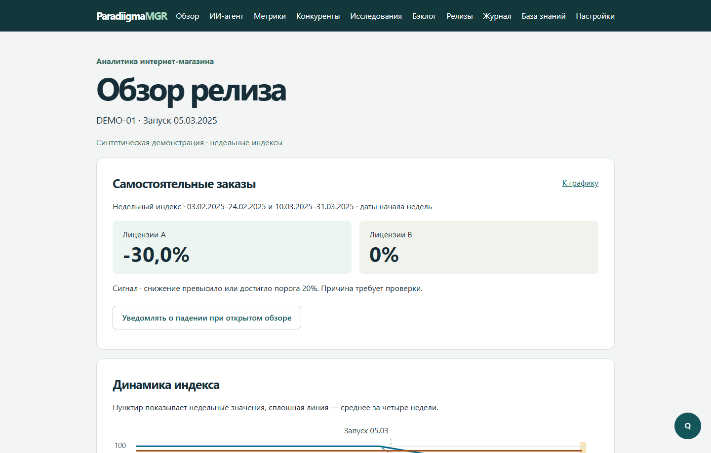
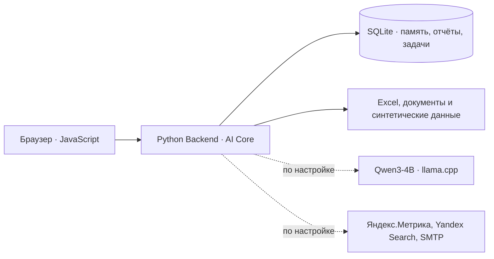

# PARADИИGMA

Помощник продакт-менеджера интернет-магазина. Сопоставляет изменение заказов с контрольным рядом, воронкой, релизами и исследованиями, сохраняет доказательства и помогает согласовать следующую проверку.

**Что можно сделать**

- Начать расследование по сигналу мониторинга или вопросу в чате. У каждого вывода есть ссылка на наблюдение и статус источника.
- Согласовать черновик задачи с целевой метрикой, сохранить его в бэклоге и выгрузить в формате Redmine JSON.
- Вернуться к расследованию и сравнить периоды в продуктовой памяти. Отдельно оценить эффект после релиза или проверить расчёт на синтетических данных.



## Быстрый запуск

Требуется Python 3.12 или новее. Пример для чистой оболочки с отдельным каталогом демонстрации.

**Linux и macOS**

```bash
python3 -m venv .venv
.venv/bin/python -m pip install --require-hashes -r deploy/requirements.lock
export PM_PRIVATE_DIR="$(mktemp -d)"
export PM_QWEN_CHAT_ENABLED=true PM_QWEN_OWNER_MODE=local
export PM_LLM_URL= PM_WORKBOOK= PM_SNAPSHOT= PM_EVIDENCE=
export YANDEX_SEARCH_ENABLED=false PM_EMAIL_ENABLED=false
.venv/bin/python app.py serve --port 8080
```

**Windows PowerShell**

```powershell
py -3 -m venv .venv
$python = '.\.venv\Scripts\python.exe'
& $python -m pip install --require-hashes -r deploy/requirements.lock
$env:PM_PRIVATE_DIR = Join-Path ([IO.Path]::GetTempPath()) ("paradiigma-demo-" + [guid]::NewGuid())
$env:PM_QWEN_CHAT_ENABLED = 'true'
$env:PM_QWEN_OWNER_MODE = 'local'
$env:PM_LLM_URL = ''
$env:PM_WORKBOOK = ''
$env:PM_SNAPSHOT = ''
$env:PM_EVIDENCE = ''
$env:YANDEX_SEARCH_ENABLED = 'false'
$env:PM_EMAIL_ENABLED = 'false'
& $python app.py serve --port 8080
```

Откройте [локальное демо](http://127.0.0.1:8080/). Пароль, внешние API и веса модели для этого сценария не нужны. Если в оболочке уже заданы настройки Метрики, импорта или мониторинга, используйте отдельную чистую сессию. [Шаблон конфигурации](.env.example)

## Демонстрация

1. Откройте вкладку «Динамика индекса» и сравните заказы с контрольным рядом.
2. В разделе «ИИ-агент» запустите расследование падения заказов. На встроенных данных доступны источники, локальные расчёты и гипотезы по правилам.
3. Согласуйте проверку, указав целевой индекс. Вернитесь к отчёту и задаче через «Журнал и задачи».
4. В карточке задачи загрузите [пример четырёх недель](data/effect-demo.json) для симуляции. Фактическая оценка задачи остаётся в статусе ожидания данных.

Для просмотра автономного отчёта выполните `python app.py build` и откройте `build/index.html`. Интерактивные функции с SQLite доступны при запуске сервера.

## Архитектура



Интерфейс обслуживается без фронтенд-сборки. Python выполняет расчёты и проверку результатов, SQLite хранит наблюдения, задачи и диалоги. Qwen при подключении выбирает инструменты и формулирует гипотезы. Для серверной установки предусмотрены Nginx, systemd и отдельное резервное копирование. [Контракт AI Core](docs/ai_contract.md) · [Развёртывание](docs/deployment.md)

## Проверки

```text
python -m unittest discover -s tests -v
python scripts/qwen/evaluate.py --mode fallback
python scripts/search_smoke.py --summary
```

Используйте Python из созданного venv. Инструкция проверяет интерфейс в браузере, продуктовую память, экспорт и восстановление. [Тестирование](docs/testing.md)

## Ограничения

- Гипотезы требуют проверки менеджером. Полнота вывода зависит от источников и настроек модели.
- Локальный бэклог экспортирует JSON. Создание задачи во внешнем Redmine требует отдельной интеграции.
- Эффект оценивается по четырём полным неделям. Встроенная симуляция показывает методику на синтетических данных.
- Ключи, рабочие источники и база состояния хранятся вне рабочей копии. При развёртывании разграничьте доступ к рабочему и демонстрационному состоянию. [Данные и память](docs/product_memory.md) · [Подключение Qwen](docs/qwen_runtime.md)

[Авторы, происхождение и лицензии](docs/credits.md)
