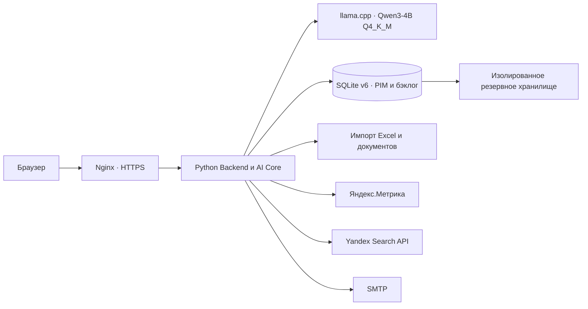
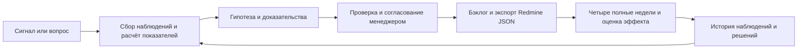

# ParadiigmaMGR

ParadiigmaMGR помогает продакт-менеджеру интернет-магазина заметить изменение показателей, проверить возможные причины и довести расследование до задачи с планом замера. Когда приходит сигнал о падении заказов, помощник сопоставляет продажи, воронку, контрольный ряд и релизы, показывает доказательства и сохраняет историю. Менеджер проверяет гипотезу, редактирует черновик и принимает решение в бэклоге.

Начните с [инструкции жюри](JURY_GUIDE.md). Она показывает весь сценарий на синтетических данных. HTTPS-адрес и учётная запись жюри передаются в составе заявки по согласованным каналам.

Состав и границы предварительной сборки приведены в [отчёте кандидата](PRELIMINARY_RELEASE.md). Для репетиции используйте [сценарий показа](DEMO_SCENARIO.md) и [инструкцию лаунчера](demo/README.md).

## Архитектура





## Запуск

Для воспроизводимого запуска используйте Python 3.12+ из чистого терминала. В PowerShell из корня проекта:

```powershell
py -3 -m venv .venv
.\.venv\Scripts\python.exe -m pip install -r requirements.txt
$env:PM_PRIVATE_DIR = Join-Path ([System.IO.Path]::GetTempPath()) ("paradiigma-jury-" + [guid]::NewGuid())
$env:PM_QWEN_CHAT_ENABLED = "true"
$env:PM_QWEN_OWNER_MODE = "local"
$env:YANDEX_SEARCH_ENABLED = "false"
$env:PM_EMAIL_ENABLED = "false"
.\.venv\Scripts\python.exe app.py serve
```

Откройте `http://127.0.0.1:8080/`. Порт можно изменить через `--port`. На macOS и Linux используйте [эксплуатационную инструкцию](docs/final_release_operator.md#локальный-запуск). Для чистой демосессии не задавайте рабочие пути к выгрузкам, Метрику или модель. Для запуска прежним способом остаётся `START_WINDOWS.cmd`. Включение живой модели описано в [runbook Qwen](docs/qwen_runtime.md).

Для автономного отчёта выполните `python app.py build` и откройте `build/index.html`. В нём доступны график, демонстрационные источники, локальный поиск по ним и черновики браузера. Пересчёт, импорт, оценка эффекта, Метрика и модель требуют локального сервера. Команда `python scripts/cost.py` создаёт пример для ссылки в интерфейсе. Для заявки используйте шаблон организатора с фактическими данными.

## Локальные данные и интеграции

Переменные перечислены в `.env.example`. Перед запуском задайте нужные переменные в процессе оболочки, например `$env:PM_SNAPSHOT = 'C:/local-data/overview.json'` в PowerShell. Приложение читает окружение процесса. Храните закрытые файлы и секреты за пределами рабочей копии.

- `PM_SNAPSHOT` читает готовый JSON-снимок. Формат показан в `data/demo-overview.json`. `PM_WORKBOOK` или `app.py serve --workbook PATH` включает расчёт из Excel. Для исходного набора задайте `PM_CASE_CONFIG` с полями `release_id`, `backlog_id`, `families` (две семьи по порядку), `channel`, `reach_product` и `periods` (даты из поля `config` исходного снимка). Пример структуры есть в `pm/settings.py`, пример книги создаёт `scripts/demo_workbook.py`.
- `PM_EVIDENCE` задаёт локальный корпус в формате `data/demo-evidence.json`. Материалы можно добавить через интерфейс или командой `python app.py import --file PATH --sheet SHEET --range A1:C3 --kind Интервью`. Индекс сохраняется в `PM_PRIVATE_DIR` или в `~/.paradiigmamgr` по умолчанию.
- `PM_LLM_URL` задаёт loopback-адрес API модели, например `http://127.0.0.1:18081/v1`. `PM_LLM_PROMPT_FILE` опционально указывает на локальное дополнение к системной инструкции UTF-8 вне рабочей копии. Модель возвращает одну гипотезу в форме вопроса и идентификаторы подтверждающих источников по схеме запроса. `scripts/run_model.py --help` описывает локальный запуск Qwen3-4B с llama.cpp. `PM_BENCHMARK` позволяет показать сохранённый результат `scripts/benchmark.py`.
- `METRIKA_COUNTER_ID` и `METRIKA_TOKEN` задаются на сервере. Интерфейс запрашивает число визитов за выбранный период. Без настроек отображается сообщение о подключении.
- `scripts/new_weeks.py --help` описывает экспорт недель из Excel для оценки эффекта. Формат JSON показан в `data/effect-demo.json`. Поля `kaspersky` и `astra` обозначают первую и вторую семьи соответственно и сохранены для совместимости.
- При сборке отчёта с закрытыми входными файлами укажите `--output` за пределами репозитория. Готовый HTML содержит данные, использованные при сборке. Калькулятор стоимости генерируется командой `python scripts/cost.py`. Для замера модели используйте `--benchmark PATH`; стандартный калькулятор использует условные числа.

## Расследование и совместная разработка

Откройте «ИИ-агент», задайте вопрос и запустите расследование. Карточка показывает доступность источников, численные наблюдения и гипотезы со ссылками. Согласование требует указать цель. История расследований и серверный бэклог хранятся в SQLite в PM_PRIVATE_DIR. Для синтетического прогона доступна симуляция эффекта.

Когда настроен локальный Qwen, агент поочерёдно читает выбранные им источники и показывает фактические шаги. Без модели расчёты и поиск работают локально. Итоги второго спринта приведены в [SECOND_SPRINT_REPORT.md](SECOND_SPRINT_REPORT.md). Для запуска Qwen3-4B и интеграции конкурентного поиска смотрите [инструкцию передачи](docs/ai_handoff.md) и [контракт API](docs/ai_contract.md).

## Ограничения

- Без Qwen остаются расчёты, локальный поиск и гипотезы по правилам. Полноценный вывод зависит от доступных данных и возможностей выбранного профиля модели.
- Бэкенд и демо работают без весов. Для живой модели файл GGUF занимает около 2,33 GiB на диске. В принятом Windows CPU профиле пик модели составил около 5,13 GiB RAM. Linux и одновременную нагрузку следует подтвердить на целевом VPS.
- В бэклоге хранится подтверждённая запись и доступен экспорт Redmine JSON. Автоматическая запись во внешний трекер вне текущей поставки.
- Фактический эффект оценивается после четырёх полных недель. Встроенные значения за этот период иллюстрируют расчёт в режиме симуляции.

## Безопасность

Подключайте рабочие источники, ключи и SQLite вне репозитория. Backend и модель в схеме развёртывания слушают loopback. Nginx завершает HTTPS и передаёт проверенную идентичность пользователя в Backend. Память рабочего контура и демонстрационные данные хранятся отдельно. У процесса приложения нет доступа к независимому vault. [Модель ролей](docs/infrastructure_security.md) · [Восстановление](docs/disaster_recovery.md)

## Экономика

Тариф модели за входные и выходные токены равен 0 ₽. Отдельно учитываются серверы, хранение, внешние вызовы и сопровождение. Команда рассчитала сценарии нагрузки для 1, 5 и 35 менеджеров. Полная цена заявки зависит от конфигурации стенда. [Допущения и тарифы](ECONOMICS_ASSUMPTIONS.md)

## Проверки

[Приёмка кода](FINAL_ACCEPTANCE.md) включает живую Qwen на Windows CPU, проверку R-09, синтетические проверки интерфейса, PIM, Search и SMTP. GitHub Actions прошёл на [ревизии кода](https://github.com/GITKITLIT/SoftlineParadiigmaMGR/actions/runs/45984517499) и [ревизии отчёта](https://github.com/GITKITLIT/SoftlineParadiigmaMGR/actions/runs/45986505399). Порядок проверки стенда описан в [операторской инструкции](docs/final_release_operator.md).

```text
python -m unittest discover -s tests -v
node --check web/app.js
python -m pip install playwright
python -m playwright install chromium
python scripts/qa_browser.py
```

Для теста с установленным Chrome или Edge можно задать `PM_CHROMIUM` полным путём к браузеру.

## Происхождение и использование ИИ

Основа этой ветки — существующий командный прототип ParadiigmaMGR. Codex использован для анализа вариантов, переноса и очистки кода, подготовки синтетических данных, инструкции и проверок, а также реализации и тестирования AI Core. При запуске продукт опционально использует Qwen3-4B через llama.cpp. Python, openpyxl и XlsxWriter используются в приложении, Playwright используется в браузерной проверке.

При заполнении заявки укажите стек, модели, объём реализации в спринте и использованные наработки согласно пунктам 4.5(2) и 4.8. [Положение конкурса «ИИкузница»](https://xn--80ancabkw0c4a.xn--p1ai/regulations/v1.html)

Лицензии основных сторонних компонентов: [Qwen3-4B — Apache 2.0](https://huggingface.co/Qwen/Qwen3-4B), [llama.cpp — MIT](https://github.com/ggml-org/llama.cpp/blob/master/LICENSE), [Python — PSF](https://docs.python.org/3/license.html), [SQLite — public domain](https://sqlite.org/copyright.html), [openpyxl — MIT](https://pypi.org/project/openpyxl/), [XlsxWriter — BSD-2-Clause](https://github.com/jmcnamara/XlsxWriter/blob/main/LICENSE.txt), [pypdf — BSD-3-Clause](https://github.com/py-pdf/pypdf/blob/main/LICENSE), [tzdata — Apache 2.0](https://pypi.org/project/tzdata/), [Playwright — Apache 2.0](https://github.com/microsoft/playwright-python/blob/main/LICENSE), [Nginx — BSD-2-Clause](https://github.com/nginx/nginx/blob/master/LICENSE). Лицензия исходного кода проекта отдельно владельцем не опубликована.


## Продуктовая память и выпуск

Раздел «База знаний» показывает исторические ряды, документы и решения. Для настройки источников, описания запросов и запуска Qwen3-4B используйте [продуктовую память](docs/product_memory.md). Для выпуска выполните [приёмку](docs/acceptance_test.md) и [проверку восстановления](docs/backup_and_recovery.md). Измерения и блокеры собраны в [отчёте Release Candidate](RELEASE_CANDIDATE_REPORT.md).
